# KI/AI-Netz — Nachschlagewerk zur KI-Welt


Eine Nachschlage- und Datenquelle zur KI-Welt: Anbieter, Modelle, Technik, Wissen, Finanzen und
Neuigkeiten, **in Deutsch, Englisch und Türkisch**. Jede Angabe trägt Quelle und Prüfdatum.
Ein Projekt von **MikaTec**.

> Statische, **abhängigkeitsfreie Website** in Vanilla HTML, CSS und JavaScript: kein Build,
> kein Framework, kein Server. Jede Seite läuft offline per Doppelklick.

## Ansichten

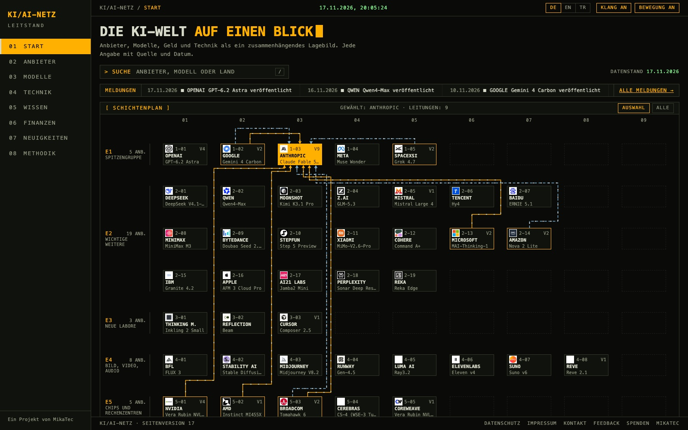

<table>
  <tr>
    <td width="50%" valign="top">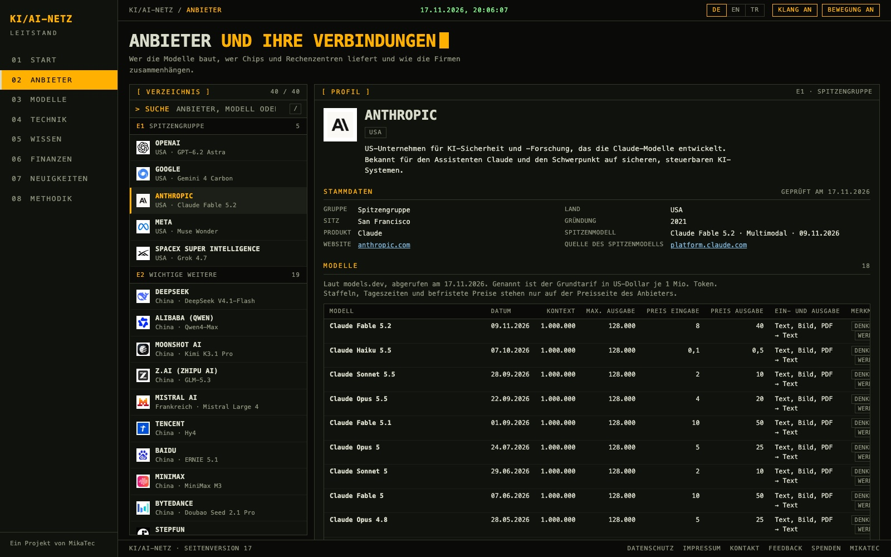<br><sub>Anbieter: Verzeichnis links, Profil mit Stammdaten, Modellen und Quellen rechts</sub></td>
    <td width="50%" valign="top">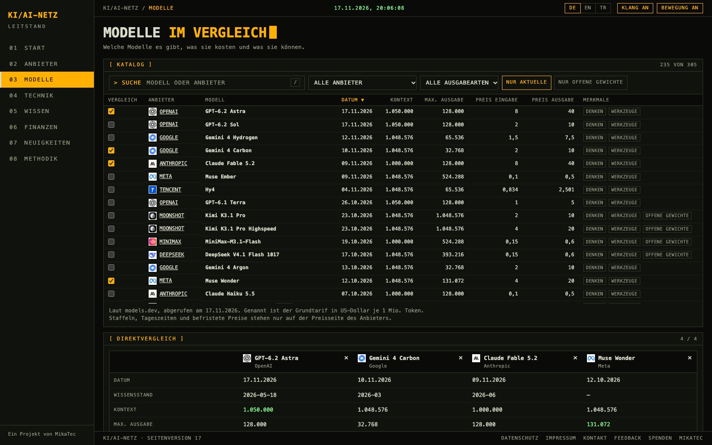<br><sub>Modelle: Katalog mit Filtern und Direktvergleich von bis zu vier Modellen</sub></td>
  </tr>
  <tr>
    <td width="50%" valign="top">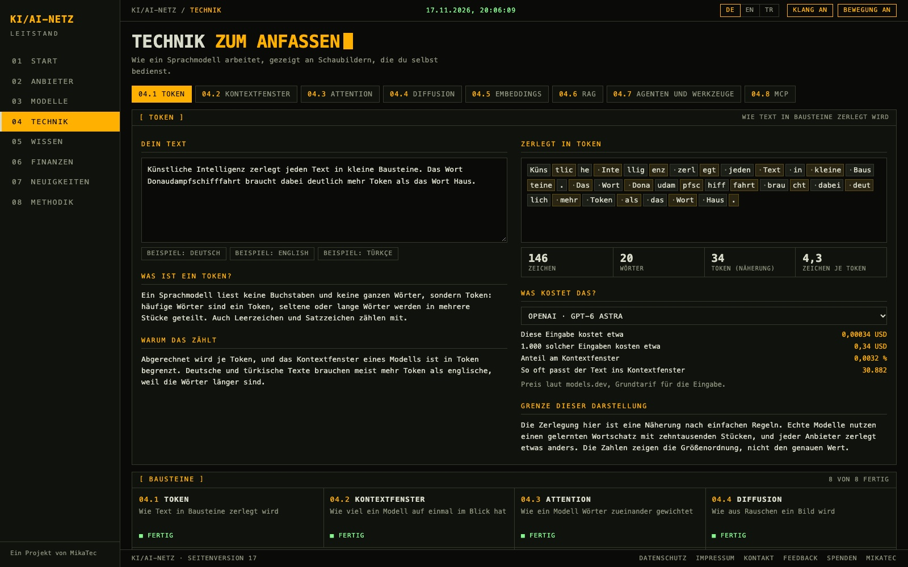<br><sub>Technik: wie Text in Token zerlegt wird und was eine Eingabe kostet</sub></td>
    <td width="50%" valign="top">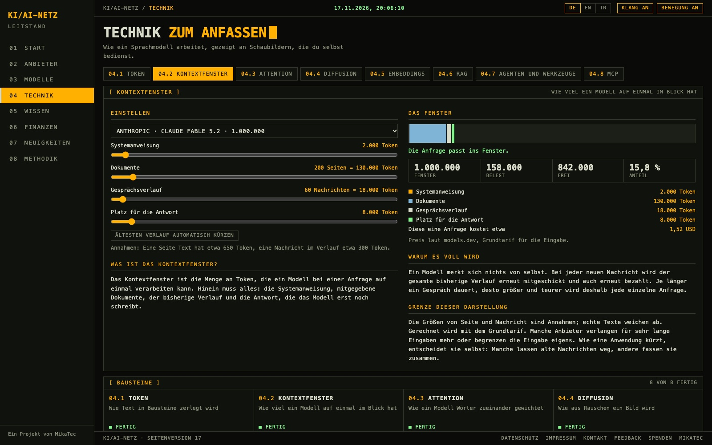<br><sub>Technik: das Kontextfenster mit Reglern füllen</sub></td>
  </tr>
  <tr>
    <td width="50%" valign="top">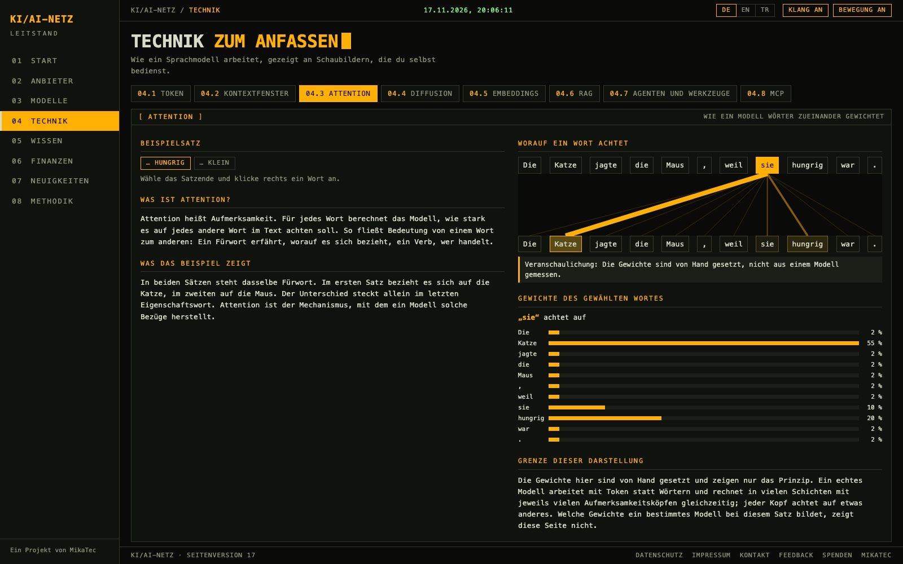<br><sub>Technik: worauf ein Wort im Satz achtet</sub></td>
    <td width="50%" valign="top">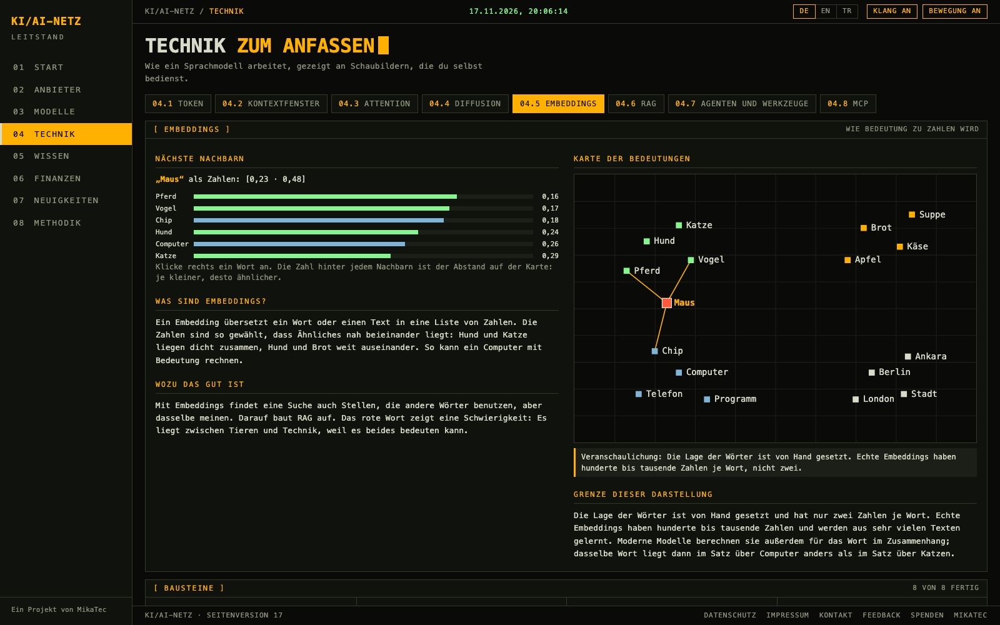<br><sub>Technik: Bedeutung als Zahlen, mit Karte der Wörter</sub></td>
  </tr>
  <tr>
    <td width="50%" valign="top">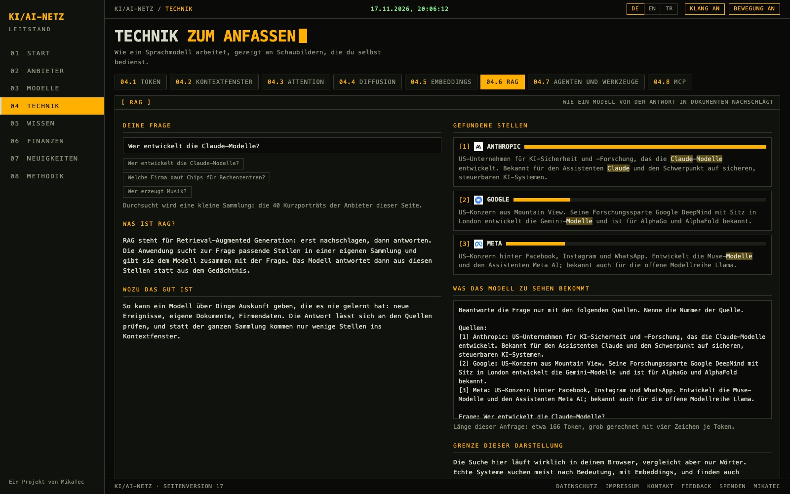<br><sub>Technik: nachschlagen vor der Antwort (RAG)</sub></td>
    <td width="50%" valign="top">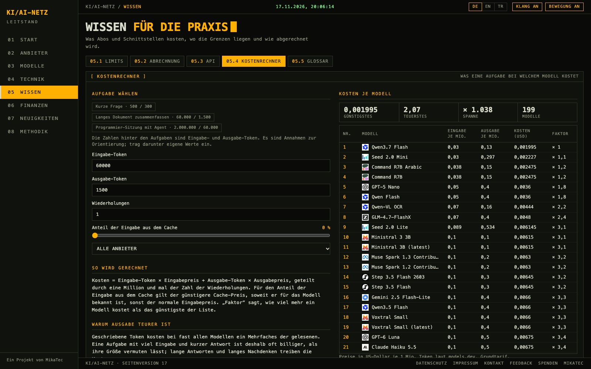<br><sub>Wissen: Kosten einer Aufgabe je Modell</sub></td>
  </tr>
  <tr>
    <td width="50%" valign="top">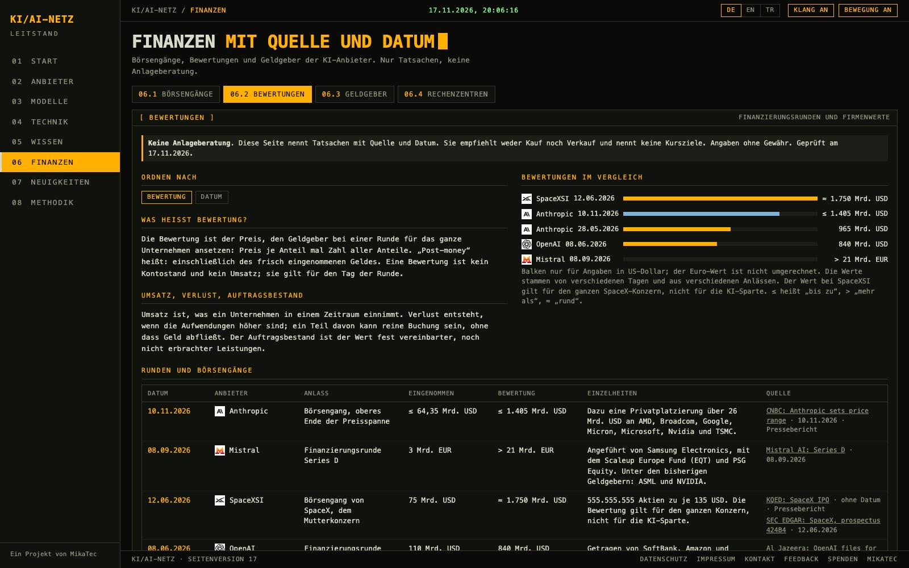<br><sub>Finanzen: Runden und Bewertungen mit Quelle und Datum</sub></td>
    <td width="50%" valign="top">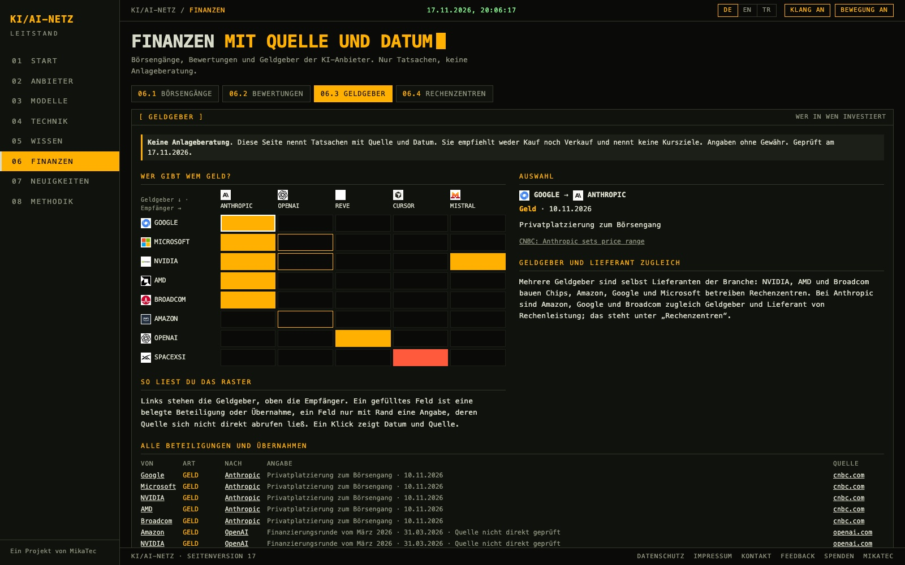<br><sub>Finanzen: wer in wen investiert</sub></td>
  </tr>
  <tr>
    <td width="50%" valign="top">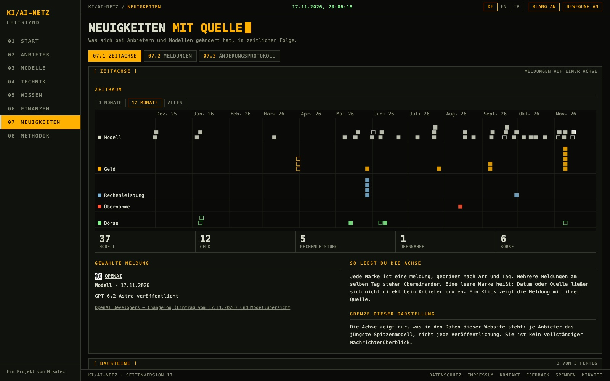<br><sub>Neuigkeiten: Meldungen auf einer Zeitachse</sub></td>
    <td width="50%" valign="top">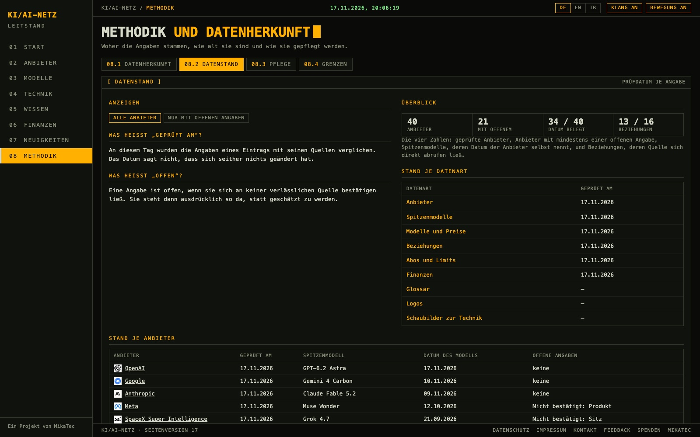<br><sub>Methodik: Prüfdatum je Datenart und je Anbieter</sub></td>
  </tr>
</table>

Die Bilder zeigen den Stand vom 17.11.2026.

## Die acht Bereiche

| Nr. | Bereich | Inhalt |
|---|---|---|
| 01 | Start | Schichtenplan der Anbieter mit ihren Beziehungen (Geld, Rechenleistung, Übernahmen), Suche, Lage in Zahlen |
| 02 | Anbieter | Verzeichnis mit Profil: Kurzporträt, Spitzenmodell, Quellen, offene Angaben |
| 03 | Modelle | Katalog mit Filtern, Direktvergleich von bis zu vier Modellen, Preis und Kontextfenster, Zeitachse |
| 04 | Technik | Acht bedienbare Schaubilder: Token, Kontextfenster, Attention, Diffusion, Embeddings, RAG, Agenten und Werkzeuge, MCP |
| 05 | Wissen | Limits der Abos, Abrechnung, API, Kostenrechner, Glossar |
| 06 | Finanzen | Börsengänge, Bewertungen, Geldgeber, Rechenzentren; nur Tatsachen, keine Anlageberatung |
| 07 | Neuigkeiten | Zeitachse und Liste der Meldungen, Änderungsprotokoll der Website |
| 08 | Methodik | Datenherkunft, Datenstand, Pflege, Grenzen |

Dazu kommt die Datenschutzseite `datenschutz.html`.

## Grundsätze

- **Quelle und Datum.** Jede Angabe nennt ihre Quelle und ihr Prüfdatum. Was sich nicht bestätigen
  ließ, steht als offen oder als „nicht bestätigt“ da und wird nicht geschätzt.
- **Näherung bleibt Näherung.** Schaubilder, die nicht messen oder rechnen, sind als Näherung oder
  Veranschaulichung gekennzeichnet; jedes nennt die Grenze seiner Darstellung.
- **Keine Rangliste, keine Empfehlung.** Die Website bewertet nicht, welches Modell besser ist. Der
  Bereich Finanzen zeigt keine Kurse und empfiehlt nichts.
- **Datensparsam.** Keine Cookies, keine Werbung, kein Profil. Die Website holt ihre Angaben beim
  Öffnen nicht von fremden Diensten. Einziger Zähler ist das cookielose GoatCounter, das nur auf
  der öffentlichen Website lädt.

## Daten

Die Daten liegen getrennt von der Darstellung in `daten/`:

| Datei | Inhalt | Herkunft |
|---|---|---|
| `anbieter.js` | Anbieter mit Kurzporträt, Spitzenmodell, Quellen | von Hand, Websites und Dokumentation der Anbieter |
| `beziehungen.js` | Beteiligungen, Rechenleistung, Übernahmen | von Hand, Firmenmitteilungen und Presse |
| `modelle.js` | Modelle mit Preisen in US-Dollar je 1 Mio. Token | per Skript von [models.dev](https://models.dev) (MIT-Lizenz, Lizenztext in `daten/LIZENZ-models.dev.txt`) |
| `abos.js` | Abos und Nutzungsgrenzen | von Hand, Preis- und Hilfeseiten der Anbieter |
| `finanzen.js` | Börsenstatus, Runden, Kennzahlen | von Hand, Firmenmitteilungen, Pflichtberichte, Presse |
| `glossar.js` | Fachbegriffe | eigene Texte |
| `protokoll.js`, `methodik.js`, `datenschutz.js` | Änderungsprotokoll, Beschreibung der Datenarten, Datenschutzhinweise | eigene Texte |

Übersetzbare Felder liegen als `{ de, en, tr }` vor; der deutsche Text ist die Vorlage. Die
Neuigkeiten haben keine eigene Datei: Sie entstehen aus den übrigen Daten. Umfang und Prüfdatum
jeder Datenart zeigt die Seite Methodik, berechnet aus den Datendateien.

Die Logos in `assets/anbieter/` sind lokal gespeicherte Originalzeichen der Anbieter. Die Rechte
daran liegen bei den Anbietern; die MIT-Lizenz dieses Repositorys gilt für sie nicht.

## Aufbau

```text
ki-ai-netz/
├── index.html, anbieter.html, modelle.html, technik.html,
│   wissen.html, finanzen.html, neuigkeiten.html, methodik.html   ← die acht Bereiche
├── datenschutz.html     ← Datenschutzhinweise
├── css/leitstand.css    ← das Erscheinungsbild
├── js/                  ← Rahmen, Texte und je Seite eigene Skripte
├── daten/               ← die Datendateien
├── werkzeuge/           ← Prüf- und Pflegeskripte für Node
├── assets/anbieter/     ← Logos der Anbieter
├── assets/ansichten/    ← Bildschirmfotos für dieses README
├── LICENSE              ← MIT-Lizenz
└── .nojekyll            ← GitHub Pages liefert die Dateien unverändert aus
```

- `js/bereiche.js` beschreibt die acht Bereiche mit ihren Bausteinen, `js/texte.js` die Texte der
  Oberfläche in drei Sprachen.
- `js/rahmen.js` baut auf jeder Seite Leiste, Kopfzeile und Fußzeile und steuert Sprache, Klang
  und Bewegung. Navigation steht links, der Inhalt rechts; gescrollt wird nur im Inhalt.
- Die Seiten binden klassische Skripte ein, keine Module, damit sie auch per `file://` laufen.
- Texte werden nie als HTML eingesetzt, sondern über `textContent`.
- Im Browser gespeichert werden nur drei Einstellungen: Sprache, Klang und Bewegung.

## Lokal ansehen

```bash
git clone https://github.com/Cehha79/ki-ai-netz.git
# index.html im Browser öffnen. Mehr ist nicht nötig.
```

## Prüfen und pflegen

Drei Skripte helfen bei der Pflege. Sie brauchen [Node](https://nodejs.org), die Website selbst
braucht es nicht.

| Befehl | Was er tut |
|---|---|
| `node werkzeuge/pruefen.js` | prüft Gerüst und Daten: drei Sprachen vollständig, Quellen und Datumsangaben vorhanden, Versionszähler auf allen Seiten gleich |
| `node werkzeuge/modelle-holen.js` | holt die Modell-Liste von models.dev, meldet neue und entfallene Modelle und geänderte Preise, schreibt `daten/modelle.js` |
| `node werkzeuge/links.js` | ruft jede Webadresse aus den Datendateien einmal ab und meldet tote Verweise |

Nach jeder Änderung an einer Datei in `css/`, `js/` oder `daten/` wird deren `?v=` auf allen
Seiten hochgezählt, die sie einbinden; sonst zeigt der Browser den alten Stand. Der vorgesehene
Prüfrhythmus steht auf der Seite Methodik unter „Pflege“.

## Veröffentlichung

Auslieferung über **GitHub Pages** aus dem Hauptzweig. Die Website ist unter
[cehha79.github.io/ki-ai-netz](https://cehha79.github.io/ki-ai-netz/) erreichbar.

## Lizenz

Der Quelltext steht unter der MIT-Lizenz (`LICENSE`). Die Modelldaten stammen von models.dev und
stehen ebenfalls unter MIT-Lizenz. Logos und Namen der Anbieter gehören den jeweiligen Anbietern.

---

Konzept und Umsetzung: © **MikaTec** · [www.mika-tec.com](https://www.mika-tec.com)
